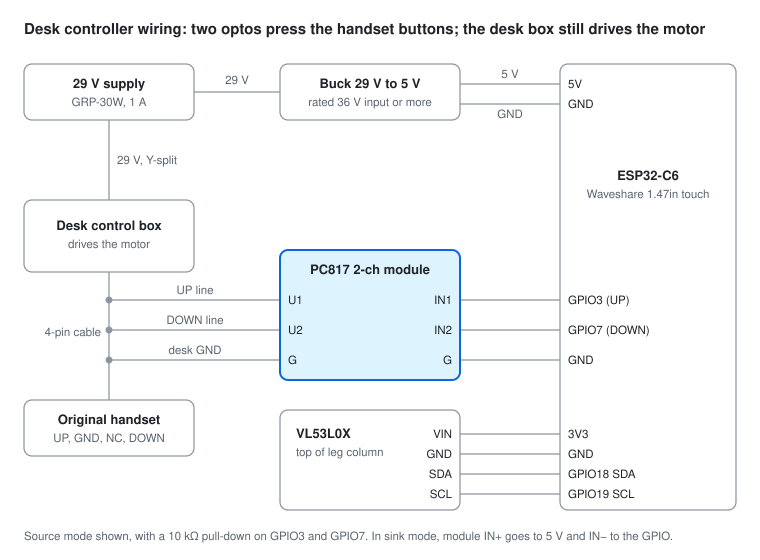

# Smart desk controller

ESP-IDF firmware for a Waveshare ESP32-C6-Touch-LCD-1.47 that drives an Otto Chatham sit-stand desk by
simulating handset button presses through PC817 optocouplers. The full plan is in
[desk-controller-spec.md](desk-controller-spec.md); progress is in [CHANGELOG.md](CHANGELOG.md).

**All stages done (6: MQTT / Home Assistant).** The optos are driven in source mode (GPIO high = button
pressed). After calibration the display and web show the desktop height, the presets drive the desk
there on their own, and the desk appears in Home Assistant through MQTT discovery.

## Build and flash

One-time toolchain install (ESP-IDF v5.5.6):

```sh
mkdir -p ~/esp && cd ~/esp
git clone -b v5.5.6 --recursive --depth 1 --shallow-submodules https://github.com/espressif/esp-idf.git esp-idf-v5.5.6
cd esp-idf-v5.5.6 && ./install.sh esp32c6
python3 tools/idf_tools.py install cmake ninja
```

Build, flash and watch the log:

```sh
. ~/esp/esp-idf-v5.5.6/export.sh
cd ~/smart-desk
idf.py build
idf.py -p /dev/ttyACM1 flash monitor     # Ctrl+] leaves the monitor
```

Options live under `idf.py menuconfig` → **Desk motion**, **Desk UI** and **Desk app** (simulator speed and range,
preset defaults, duty budget, auto-lock/dim timeouts, units, backlight).

## First-boot setup

1. Power the desk controller. With no Wi-Fi saved, it starts an open network called
   `Desk-Setup-XXXX` and shows that name and `192.168.4.1` at the top of its screen.
2. Join that network from a phone. The setup page should open by itself; if not, browse to
   `http://192.168.4.1`.
3. Settings → Wi-Fi → **Scan**, tap your network, enter its password, set a hostname, **Save**.
4. Rejoin your normal network and open `http://<hostname>.local` (default `http://desk.local`).
   The screen shows the desk's IP address.
5. Optionally set an admin password (Settings → Admin password) to protect Settings and System.

If the saved network is unreachable for 60 s, the setup network comes back so you can fix it.
Factory reset (System tab) erases all settings.

## Web interface

- **Control**: live height and state, hold ▲/▼ to move (stops on release, tab close or lost
  connection), preset buttons, STOP.
- **Settings**: Wi-Fi, hostname, time server, presets, display units and timeouts, backlight, MQTT
  (broker, login, device ID, move countdown, optional TLS CA), and **Allow remote moves**. With it off (the default), the web page can only move
  the desk while the desk's screen is unlocked. STOP always works.
- **Sensor**: VL53L0X diagnostics: filtered and raw distance, range status, signal and ambient rate,
  samples per second, standard deviation over 2 s, a plot of the last 30 s (raw dots, filtered line,
  bad samples in red), a stillness summary over the last 10 s, CSV download of the last 60 s, and the
  ranging profile (default 50 ms / high accuracy 200 ms) and filter alpha. `GET /api/sensor?since=<n>`
  and `GET /api/sensor.csv` give the same data to scripts.
- **System**: calibration (start the routine, export / import it as JSON), firmware and network info, last fault, duty budget, reboot, factory reset, firmware
  update (upload `build/smart_desk.bin`; a firmware that fails to start rolls back automatically).

The clock is set by NTP: first a server offered by DHCP, then the **Time server** setting (blank means
the router/gateway), then pool.ntp.org. It is only used for log timestamps.

## Using the touchscreen

- Boots to the **lock screen**: current height, status icons (Wi-Fi/MQTT placeholders, fault warning),
  and a slide-to-unlock knob. Drag it at least 85 % of the way; a shorter slide springs back.
- **Control screen**: hold ▲ / ▼ to move the desk (it stops on release), tap SIT / STAND to go there.
  While it is moving on its own, a touch anywhere stops it. **Long-press** SIT / STAND to save the
  current height as that preset. A message shows where the desk landed. "Lock" returns to the lock
  screen.
- Auto-locks after 30 s without a touch; dims after 60 s locked. The first touch on a dim screen only
  wakes it.
- The line under the height shows the sensor's filtered distance ("sensor 80 mm (uncalibrated)"), or
  "sensor offline".
- The gear button (control screen) opens **Settings**: calibration status, **Calibrate desk**, and
  **Sensor details**.
- **Long-press the status row** (top of the screen) for the sensor debug screen: filtered and raw mm,
  range status, rate, standard deviation and span over 2 s, signal / ambient rate, profile, alpha and
  error counts. Back returns; it also times out (auto-lock time if opened unlocked, 5 min if locked).
- **Cooldown** (duty budget used) shows a countdown; **Fault** shows the reason and needs Acknowledge.

### Serial console

The board's USB port gives a `desk>` prompt (e.g. through `idf.py monitor`):

| Command | Does |
| --- | --- |
| `status` | State, height, target, duty budget, fault, last error, heap |
| `stop` | Stop any movement |
| `goto <mm>` | Seek to a height |
| `sensor` | Height sensor readings, noise, profile and error counts |
| `cal` | Calibration status; `cal begin`, `cal start`, `cal height <mm>`, `cal save`, `cal discard`, `cal cancel`, `cal close`, `cal correct <mm>` |
| `scan` | I2C bus scan |
| `time` | Clock and NTP server status |
| `fault [text]` | Debug: raise a fault (test the fault screen) |
| `duty <s>` / `duty clear` | Debug: use up duty budget / reset the ledger (test the cooldown screen) |
| `crash` | Debug: null-pointer crash (test reset behaviour) |

The duty ledger is kept in RTC memory, so it survives resets and crashes but not a power cycle.

## Stage 2 bench test (do this before trusting the desk connection)

1. Flash, then put a multimeter in continuity or diode mode across each opto output (V1–G, V2–G).
   It must conduct only while the matching ▲ / ▼ button is held on the touchscreen.
2. Reset the board, and power it up while holding BOOT. Neither output may conduct at any point
   (watch the module's indicator LEDs too).
3. Hold ▲ on the web page and close the tab: the output must drop within 300 ms.
4. With the desk connected: it moves while ▲ / ▼ is held (touchscreen and web) and stops on release;
   the original handset still works; no movement during power-up, reset, flashing or the `crash`
   console command.
5. Duty budget: `duty 110` on the console, then jog for ~10 s; the desk must stop and show the cooldown
   countdown. `duty clear` resets it.

Console commands and the log show every output change with time, source and reason
(`OUT OFF -> UP src=TOUCH reason=jog`).

Polarity and pins are Kconfig options (`Desk motion`): `DESK_OPTO_ACTIVE_LOW` (sink mode),
`DESK_OPTO_UP_GPIO`, `DESK_OPTO_DOWN_GPIO`. `DESK_SIMULATOR` brings back the simulated desk (outputs
held off). `DESK_HANDSET_SENSE` (off) reads the handset lines to detect physical presses.

The 10 kΩ pull-downs on GPIO3/GPIO7 are not fitted yet. The firmware enables the internal pull-downs
once it is running, but nothing holds the pins low while the chip is in reset.

## Height sensor (stage 3)

The VL53L0X shares the onboard I2C bus with the touch controller, behind a bus mutex. The `height`
task polls it every 10 ms in continuous mode, drops samples with a bad range status, takes the median
of the last 5 good samples and smooths that with an EMA (alpha 0.3 by default). The filtered reading
goes invalid after 500 ms without a good sample. If the sensor stops answering it is marked offline
straight away and re-initialised with back-off (0.5 s up to 5 s), so it can be unplugged and plugged
back in without a reboot. A touch read that fails on the shared bus counts as "not touched" instead of
crashing the UI.

Kconfig (`Desk height sensor`): `DESK_HEIGHT_BUDGET_MS` (50), `DESK_HEIGHT_BUDGET_ACCURATE_MS` (200),
`DESK_HEIGHT_EMA_PCT` (30). The profile and alpha can also be changed live from the Sensor tab (saved in
settings).

If the screen goes black and the board keeps rebooting with `probe device timeout` in the log, the
sensor is holding the bus low: check its VIN/GND (an unpowered breakout pulls SDA/SCL down) and that
SDA/SCL go to GPIO18/19. The boot scan now reports "bus not responding" in that case.

Hot-unplug test (done 2026-11-06, after stage 4): unplugging the sensor shows "sensor offline" at once;
plugging it back in brings the reading back without a reboot.

**Stillness noise** (desk still for 10 s, default profile, measured 2026-11-06 with the sensor mounted):

| Position | Filtered mean | Filtered std dev | Filtered min/max | Raw std dev | Raw min/max | Signal |
| --- | --- | --- | --- | --- | --- | --- |
| Bottom | 50.2 mm | 0.44 mm | 49.1 / 51.0 | 1.08 mm | 46 / 54 | 27.3 MCPS |
| Middle | 292.9 mm | 0.76 mm | 291.2 / 294.4 | 1.72 mm | 287 / 297 | 9.2 MCPS |
| Top | 529.7 mm | 1.10 mm | 527.4 / 533.3 | 3.40 mm | 517 / 539 | 2.8 MCPS |

All within ±5 mm filtered (worst ±3 mm at the top, where the return signal is weakest). No bad
samples in any window. The reading rises as the desk goes up: about 480 mm of travel at ~15.5 mm/s
in both directions, so a full end-to-end run takes ~31 s, longer than the 25 s uncalibrated max move
time (stage 4 must allow for that).

## Calibration (stage 4)

Start it from the display (gear > Calibrate desk) or the web System tab (the desk display must be
unlocked). It checks there is at least `DESK_CAL_MOTOR_S` (90 s) of motor time left; if not it shows
how long to wait and opens the start prompt by itself once there is. Then, after "Clear the area ...
Start":

1. Probe: UP until the reading moves 20 mm (2-3 s); that gives the sign. If the desk is already at the
   top it probes DOWN instead. No change either way: "Sensor not seeing the target".
2. UP to the top stop (reading changes < 2 mm over 1 s while driven): `raw_max`.
3. Two coast tests DOWN: 3 s run, release, wait for the reading to settle.
4. DOWN to the bottom stop: `raw_min`.
5. Two coast tests UP.
6. Back DOWN to the bottom stop; the bottom reading must repeat within 15 mm.
7. Enter the desktop height measured from the floor at the bottom (on-screen keypad or the web form).
8. Summary, then Save or Discard.

Height model: `height = h_min + sign × scale × (reading − raw_min)`. Usable range is `h_min + 5` to
`h_max − 5` mm. Max single move time becomes travel / slowest speed × 1.3 (39 s on this desk).
Coasts are measured on the filtered reading, from release to the settled value.

Differences from the spec, both because a full run on this desk takes ~31 s:

- Order: the spec goes bottom → top → bottom → coast tests, which needs ~105 s of motor time (close
  to the 120 s budget) and over 2 minutes of wall time. The order above needs at most ~75 s and runs
  in ~80 s.
- Long runs are split into segments of at most 20 s with a 1 s pause, so no single move gets near the
  25 s uncalibrated max move time (that limit is unchanged).

A touch anywhere on the screen, STOP (web, console, handset if sensed) or Cancel stops the desk at
once and keeps the old calibration. The routine also stops on a fault, when the motor budget runs out,
if the sensor reading is lost, or after 3 minutes. Calibration is stored in NVS (`cal` key, with a
version and timestamp) and erased by a factory reset. Export / import: `GET` / `PUT /api/calibration`.

**Correct height** (display: gear > Correct height; web: System > Calibration; console `cal correct <mm>`):
tape-measure the desk where it is and enter it. At least 150 mm above the bottom it sets `scale`
(keeping `h_min`); nearer the bottom it corrects `h_min`. The desk does not move. This is an addition
to the spec, which maps the sensor with one tape measurement only: on this desk the VL53L0X reads
distances about 7 % long (a cosine error from the mounting angle has the same effect), which puts the
top ~35 mm out with `scale` = 1. The scale is kept when the routine is run again.

Measured on this desk (2026-11-06): sensor travel 478 mm (52.3 → 530.6), 15.8 mm/s up, 16.0 mm/s
down, coast about 11 mm each way (sensor mm), bottom repeats within 0.1 mm, top within 0.1 mm,
routine 78 s. Tape measure: 725 mm at the bottom, 954 mid, 1163 near the top. A straight-line fit through
those points gives `scale` 0.931, so the desk is 725-1170 mm; displayed vs tape after the correction:
725 / 725, 953 / 954, 1163 / 1163.

Cancel tests: web STOP while heading for the top, and web Cancel during a coast test: output off
within 1 ms, old calibration unchanged.

## Presets (stage 5)

A preset (display tap, web button, console `goto <mm>`) is refused if the desk isn't calibrated, is
cooling down or faulted, the sensor is invalid, less than 10 s of motor time is left, or the target is
outside the usable range (no clamping). Within ±8 mm it does nothing. Otherwise:

1. Drive towards the target and release when the remaining distance is at most the learned coast
   for that direction + 2 mm (`DESK_SEEK_MARGIN_MM`).
2. Settle: wait until the reading changes < 2 mm over 500 ms (2 s at most).
3. If still more than ±8 mm out (`DESK_SEEK_TOLERANCE_MM`), one correction pulse
   (error / speed, at least 150 ms), then settle again. Never more than one.
4. Learn: after an approach that ran at least 2 s, move the coast for that direction 20 % of the way
   to the observed one (`DESK_COAST_LEARN_PCT`), within ±50 % of the calibrated value. Saved at most
   once an hour; a new calibration resets it.
5. Report the final height and error (display and web message, `last_seek` in the status JSON).

Safety added in this stage:

- **Stall** (invariant 6, JOG and SEEK once calibrated): if the height changes < 5 mm over 1.5 s
  while the output has been on for at least 2 s (the first 2 s are skipped for the soft start and filter
  lag), stop and FAULT "Desk not moving". A jog held into an end stop (within 15 mm of it) just stops
  with "At the top / bottom" instead.
- **Plausibility** (seeks): a reading that changes faster than 1.5 × the calibrated speed (+3 mm
  noise allowance, over 0.5 s) means something is in the beam: stop and FAULT. A lost reading during a
  seek is a FAULT too.
- Any touch on the screen, STOP (web/console) or a sensed handset press stops a seek at once.

Tested (2026-11-06): 10 Sit/Stand seeks via the web preset buttons, all within ±5 mm of the target
(Stand −1 to −4 mm, Sit +2 to +5 mm), no corrections needed; small seeks get one correction pulse
(e.g. 12 mm away → +2 mm). Settles ~1.2 s after release. The learned coast drifted from ~12.5 to
~11 mm over those runs.

**Control box lockout.** Twice after heavy use (calibration + tests; ~10 back-to-back seeks) the
control box stopped the desk mid-move and ignored it (firmware and handset) until its power was
cycled. That looks like the box's own overload/duty protection, which seems stricter than the
firmware's 120 s per 20 min budget. Both times the stall check stopped driving within 1.5 s and
raised "Desk not moving (stall)". If that fault appears with no obstruction, power-cycle the control
box. Lowering `DESK_DUTY_MAX_ON_S` would make the firmware rest the desk before the box does.

## Home Assistant / MQTT (stage 6)

Set the broker in Settings > MQTT (`mqtt://host:1883` or `mqtts://host:8883`; for `mqtts://` paste the
broker's CA, or leave it empty to use the built-in public CA list). The device ID defaults to the
hostname. The client reconnects with back-off from 1 s up to 60 s, and straight away when Wi-Fi comes
back. The MQTT label on the display is lit while connected; System shows the state and last error.

| Topic | |
| --- | --- |
| `desk/<id>/status` | `online` / `offline`, retained (last will) |
| `desk/<id>/state` | retained JSON: `height_mm`, `state`, `target_mm`, `fault`, `duty_remaining_s`, `locked`, `remote_moves_allowed`, `last_error`, `calibrated`, `pending_target_mm`; 2 Hz while moving, on change (height ≥ 5 mm when idle), every 60 s |
| `desk/<id>/cmd` | `{"cmd":"preset","id":"stand"}` (sit, stand, custom1, custom2), `{"cmd":"goto","mm":1080}`, `{"cmd":"stop"}` |
| `homeassistant/<component>/<id>_<object>/config` | discovery, retained; republished when HA sends `online` on `homeassistant/status` |

Entities (one device, with a link to `http://<hostname>.local`): Height, Target height (number,
calibrated range, step 10 mm), one button per enabled preset, Stop, State, Moving, Fault (with the fault
text as an attribute), and diagnostics Duty budget remaining, Remote moves allowed, Last error.

Rules: Stop is always accepted. Preset / goto need **Allow remote moves**; otherwise they are refused
and the reason shows as Last error. At most one move command per 2 s. No jogging over MQTT. A move
starts only after a countdown on the desk screen (default 3 s, 0-10 s in Settings); a tap on the
screen, or STOP from anywhere, cancels it. A move that is running carries on if Wi-Fi or the broker
drops.

Tested with Josh's Home Assistant: device and entities appear by themselves and survive an HA
restart; Stand / Sit after the countdown; tap cancels the countdown; HA Stop stops a move; with
remote moves off nothing moves and Last error explains why; reconnects after a reboot.

## Wiring



The two optocouplers sit in parallel with the original handset's UP and DOWN buttons, so the handset
keeps working and the desk control box still drives the motor. The ESP32 runs off a buck converter
fed from the desk's own 29 V supply, so everything shares one ground.

Parts:

- Waveshare ESP32-C6-Touch-LCD-1.47
- 2-channel PC817 optocoupler module (terminal names vary by module: inputs I1/I2 or IN1/IN2,
  outputs V1/V2 or U1/U2)
- VL53L0X time-of-flight breakout, mounted at the top of the leg column looking down, so the reading
  changes with desk height
- Buck converter, 29 V to 5 V, rated for 36 V input or more
- Y-split barrel lead for the 29 V supply (the stock supply here is a GRP-30W, 29 V 1 A)
- 2 × 10 kΩ resistors for the GPIO pull-downs (recommended; see the note in the table)

Handset cable (4 pins): UP, GND, NC, DOWN. Tap the UP, DOWN and GND lines between the handset and the
control box. A button press pulls its line to GND; the opto output does the same.

Pin numbers come from [main/board_config.h](main/board_config.h).

| From | To | Notes |
| --- | --- | --- |
| 29 V supply | Desk control box DC input | Y-split on the barrel lead |
| 29 V supply | Buck converter input | Buck rated 36 V input or more |
| Buck 5 V / GND | ESP32 board 5V / GND | |
| Handset cable UP line | PC817 module V1 | In parallel with the handset button |
| Handset cable DOWN line | PC817 module V2 | |
| Handset cable GND | PC817 module output G | Desk GND |
| ESP32 GPIO3 (UP) | PC817 module I1 | Source mode; 10 kΩ pull-down on the GPIO (recommended, not yet fitted) |
| ESP32 GPIO7 (DOWN) | PC817 module I2 | 10 kΩ pull-down on the GPIO (recommended, not yet fitted) |
| ESP32 GND | PC817 module input G | |
| ESP32 3V3 / GND | VL53L0X VIN / GND | |
| ESP32 GPIO18 / GPIO19 | VL53L0X SDA / SCL | Shared onboard I2C bus; leave XSHUT / GPIO1 unconnected |

In sink mode the module's input + goes to 5 V and input − to the GPIO, with a pull-up instead of the
pull-down. GPIO3 is also the TF-card MISO line; the TF card is never used and its CS (GPIO4) is held high.

I2C devices found at boot: 0x29 (VL53L0X), 0x63 (AXS5106L touch), 0x6b (QMI8658 IMU, unused).

## Case

[hardware/smart-desk-case.stl](hardware/smart-desk-case.stl) is a 3D-printable case that holds the
ESP32 board and the other components (GitHub shows a 3D preview when you open the file).

## Layout

```
main/            app_main, board_config.h, serial console
components/
  board/         buses, display, touch, backlight
  jd9853/        LCD panel driver
  axs5106/       touch driver
  motion/        motion state machine, safety invariants, duty ledger (simulator in stage 0)
  vl53l0x/       VL53L0X driver (C port of Pololu's library)
  height/        sensor task, filter, 60 s history
  ui/            LVGL screens
  config/        settings in NVS
  mqtt_ha/       MQTT client, Home Assistant discovery, commands
  net/           Wi-Fi, setup AP + captive DNS, mDNS, SNTP
  web/           HTTP server, REST API, WebSocket, OTA
web/index.html   the web app (gzipped into the firmware at build time)
tools/serlog.py  serial log capture for scripts
docs/wiring.svg  wiring diagram
hardware/        3D-printable case (STL)
```
